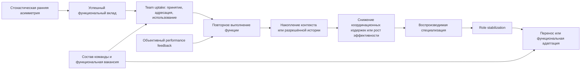

# AI Leadership Arena — Conceptual Model

**Версия:** 0.1  
**Дата:** 11 августа 2026 года  
**Статус:** рабочая фальсифицируемая модель, предшествующая реализации  
**Основание:** `LITERATURE_REVIEW.md` v0.4 audited working baseline

## 1. Назначение

Документ превращает обзор литературы в систему проверяемых утверждений. Он не
предполагает, что роли существуют заранее, и не приписывает агентам личность,
намерение или субъективную мотивацию. Предмет исследования — наблюдаемая
динамика функций в системе `agent × team × task × history`.

Главный механистический вопрос:

> Через какие механизмы взаимодействия, если вообще через какие-либо,
> первоначально временная функциональная дифференциация превращается в
> воспроизводимую специализацию в командах однородных LLM-агентов?

## 2. Концептуальная лестница

### 2.1. Functional differentiation

В одном эпизоде агенты наблюдаемо выполняют разные функции. Различия превышают
перестановочный baseline, сохраняющий задачу, объём коммуникации и порядок
ходов. Это состояние внутри эпизода; оно ещё не является специализацией.

### 2.2. Functional specialization

Сходный многомерный функциональный профиль одного persistent agent ID
воспроизводится в нескольких сопоставимых задачах или эпизодах сверх
stateless, ID-only и случайно сопоставленных baseline. Специализация описывает
повторяемость поведения, но ещё не доказывает социальное закрепление.

### 2.3. Role stabilization

Специализация поддерживается контуром взаимодействия: партнёры адресуют агенту
сходные функции, принимают или используют его вклад и уменьшают дублирование.
Нужно временное свидетельство, что team uptake предшествует последующему
повторению функции, а не просто совпадает с ним.

### 2.4. Persistent behavioral role profile

Многомерный профиль, который одновременно:

1. превышает нулевые baseline;
2. воспроизводится между задачами;
3. не объясняется порядком, длиной сообщений, задачей или подсказкой памяти;
4. демонстрирует перенос либо предсказуемую адаптацию после смены команды;
5. подтверждается действиями агента и структурой взаимодействий.

Слово **role** разрешено только после этих проверок. До них используются
`difference`, `differentiation`, `profile` и `specialization`.

## 3. Предполагаемый причинный граф

Граф является набором кандидатных причинных стрелок. Наблюдение конечного
паттерна не подтверждает автоматически промежуточные механизмы.

## 4. Проверка и опровержение причинных стрелок

| ID | Причинная стрелка | Наблюдаемые величины | Ключевой контроль или манипуляция | Что опровергает стрелку |
|---|---|---|---|---|
| E1 | ранняя асимметрия → успешный вклад | ранний профиль; независимая оценка качества | сбалансированный порядок; seeds; одинаковые prompts/tools | ранняя функция не предсказывает качество лучше нулевого распределения |
| E2 | успешный вклад → team uptake | принятие; ссылки; адресованные запросы; использование результата | варьирование доступной информации о качестве при неизменном содержании | качество не предсказывает uptake после контроля позиции и длины |
| E3 | team uptake → повторение функции | функция следующего вклада; адресат; временной порядок | сопоставимые вклады без uptake; будущая recognition perturbation | uptake не меняет вероятность повторения функции |
| E4 | повторение → накопленная история | число повторов; содержание разрешённой памяти | `P1` против `P2-control` и `P2` по контрактам протокола | controlled history не повышает сходство относительно ID-only и stateless |
| E5 | история → эффективность | качество, ошибки, ходы, latency, tokens, дублирование | одинаковая задача и бюджет; релевантная, удалённая или переставленная история | эффект отсутствует или объясняется длиной контекста |
| E6 | эффективность → дальнейшая специализация | вероятность функции после объективного результата | `P2` против `P2-feedback`; feedback без ролевых ярлыков | feedback не меняет последующее распределение функций |
| E7 | повторяемость → specialization | межзадачное сходство; bootstrap stability | stateless, ID-only, случайное сопоставление IDs, task-family holdout | сходство не превышает baseline или ограничено одной task family |
| E8 | specialization + recognition → stabilization | взаимное предсказание действий и адресации партнёров | удалить/перенаправить recognition; temporal precedence | ожидания партнёров не воспроизводятся или не предсказывают действия |
| E9 | stabilized profile → transfer/adaptation | сохранение профиля; сдвиг к вакансии; качество команды | `P3-control/P3`; reshuffling; leave-one-agent-out vacancy | профиль исчезает либо сдвиг не соответствует независимо измеренной вакансии |

## 5. Экспериментальная логика

Фазы эксперимента и контракты памяти — разные оси. Обозначения `M0–M3`
зарезервированы только за политиками памяти из `RESEARCH_PROTOCOL.md`.

| Сравнение | Что оно идентифицирует | Какие стрелки проверяет |
|---|---|---|
| поведение внутри `P1` | context-only differentiation и естественная вариативность | E1–E3 |
| `P1` vs `P2-control` | эффект persistent ID без доступной агенту истории | отрицательный контроль для E4 и E7 |
| `P2-control` vs `P2` | добавочный эффект controlled self-history | E4, E5, E7 |
| `P2` vs `P2-feedback` | эффект performance signal сверх истории | E6 |
| `P2` vs `P3` | перенос и адаптация после смены окружения | E8, E9 |
| `P3-control` vs `P3` | перенос, поддерживаемый историей, против ID-only | E7–E9 |

## 6. Конкурирующие модели

- **Stochastic interchangeability:** различия не превышают вариативность
  генерации и не воспроизводятся.
- **Context-only differentiation:** различия существуют внутри transcript, но
  исчезают после очистки контекста.
- **Agent-history persistence:** controlled self-history повышает
  повторяемость после контроля одной лишь метки ID.
- **Team-assigned stabilization:** партнёры восстанавливают функцию через
  адресацию и использование вклада, включая случаи без self-history.
- **External optimization:** специализация возникает или усиливается только
  после объективной обратной связи.

Эти модели могут сосуществовать; анализ должен оценивать их отдельный вклад.

## 7. Правила интерпретации

- Успех одного запуска не считается differentiation.
- Повторение функции не считается specialization без сравнения с baseline.
- Specialization не считается stabilization без независимых признаков team
  uptake и корректного временного порядка.
- Стабильность от прямого ролевого ярлыка в памяти является artefact.
- Перенос означает сохранение сверх baseline; адаптация — направленный сдвиг к
  вакансии, определённой без поведения целевого агента.
- Лучший результат команды не доказывает механизм: каждое ребро требует
  отдельной проверки.
- Отсутствие эффекта на ступени ограничивает допустимый вывод предыдущей
  ступенью и является содержательным результатом.

## 8. Критерии, требующие согласования

До версии 0.2 протокола необходимо заранее определить:

1. минимальный эффект для признания differentiation;
2. метрику и порог межзадачного сходства specialization;
3. минимальное временное и статистическое свидетельство team uptake;
4. критерий bootstrap stability многомерного профиля;
5. границы переноса между task families;
6. минимальный направленный сдвиг для признания adaptation;
7. правила множественных сравнений и подтверждающего анализа.

## 9. Критерий готовности к протоколу v0.2

После согласования раздела 8 каждая подтверждающая гипотеза должна ссылаться
на конкретные рёбра `E1–E9`, переменные, контроли и заранее определённое
опровергающее наблюдение.
